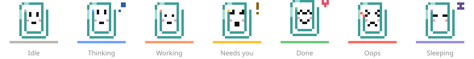

# Familiar

A pixel pet that lives in the corner of your GNOME desktop and shows what [Claude Code](https://code.claude.com), [opencode](https://opencode.ai) or [Pi](https://pi.dev) is doing: thinking, running a tool, waiting for your permission, finished, or asleep. It stays visible when your terminal is minimized, so you can get on with other work and look up when it waves at you.



- **12 built-in pets**, plus your own: pets are pixel art in a JSON file.
- **Every running Claude Code, opencode and Pi session** reports in; the pet shows the most urgent one.
- **Configurable**: moods, messages, colors, which events trigger what, size and timing. Changes apply as soon as you save.
- **Out of the way**: hide it, tuck it at the screen edge, or switch corners from a top-bar menu.

## Contents

- [Requirements](#requirements)
- [Install](#install)
- [Using it](#using-it)
- [The pets](#the-pets)
- [Make your own pet](#make-your-own-pet)
- [Configuration](#configuration)
- [How it works](#how-it-works)
- [Troubleshooting](#troubleshooting)
- [Uninstall](#uninstall)
- [Development](#development)

## Requirements

| | |
| --- | --- |
| Desktop | GNOME Shell **50** (tested on Ubuntu, Wayland). Other versions need `shell-version` in [`metadata.json`](extension/familiar@tmurphy-credibly.github.io/metadata.json) widened, and may need code changes. |
| Claude Code | Any recent version with hooks (`PermissionRequest`, `PostToolUseFailure`, `StopFailure` are used). |
| opencode | Optional. **2.x**, or **1.18.29** and newer 1.x. One plugin file supports both. |
| Pi | Optional. **1.x** (`@earendil-works/pi-coding-agent`) or **0.7x** (`@mariozechner/pi-coding-agent`). |
| Tools | `bash`, `jq`, `gsettings`, `gnome-extensions` |
| Optional | `node` to validate pets and run tests, `python3` to regenerate the built-in pets |

Check your GNOME version with `gnome-shell --version`.

## Install

```bash
git clone git@github.com:tmurphy-credibly/familiar.git ~/familiar
~/familiar/install.sh
```

Then **log out and back in once**. On Wayland, GNOME can't load a new extension into a running session.

`install.sh` does up to five things, and is safe to run again:

1. Links `extension/familiar@tmurphy-credibly.github.io` into `~/.local/share/gnome-shell/extensions/`.
2. Adds it to GNOME's enabled extensions.
3. Registers `hooks/familiar-hook.sh` for 11 events in `~/.claude/settings.json`. Your existing hooks are kept, and a backup is written to `~/.claude/settings.json.bak-familiar`.
4. If opencode is installed, links `opencode/familiar.js` into `~/.config/opencode/plugins/` (2.x) or `~/.config/opencode/plugin/` (1.x). Your opencode config is not edited.
5. If Pi is installed, links `pi/familiar.js` into `~/.pi/agent/extensions/` (or `$PI_CODING_AGENT_DIR/extensions/`).

The hooks take effect in new Claude Code sessions straight away. opencode 1.x picks up the plugin in new sessions; opencode 2.x runs plugins in its background service, so run `opencode service restart` once. Pi picks up the extension in new sessions, or after `/reload`. Keep the clone where it is: the extension and the hooks point into it.

**Upgrading from Claude Pet?** This project used to be called Claude Pet. `git pull`, then run `install.sh` again and log out and back in. It moves `~/.config/claude-pet` to `~/.config/familiar`, swaps the old extension, hooks and opencode link for the new ones, and leaves your other hooks alone. If you renamed or moved the clone, run `install.sh` from its new location.

To update, `git pull`. Pet and config changes apply immediately; extension code changes need another log out and back in.

## Using it

**On the desktop.** The pet starts in the bottom-right corner. When your agent needs you, finishes, or hits an error, a speech bubble says so: which project, and what it wants, such as "Can I run Bash?" with the command.

- **Drag** the pet anywhere, on any monitor. It remembers the spot. The bubble opens toward the middle of the screen, and below the pet when it's near the top.
- **Click** the pet or the bubble to bring up your terminal. It picks the most recently used terminal window, preferring one whose title contains the project name.
- **Hover** to see the bubble any time, plus a small toolbar to tuck the pet away or snap it to the other corner.
- **Tucked away**, the pet peeks over the bottom edge of its monitor and rises when something urgent happens. Click or drag it to bring it back.
- **Monitor unplugged?** The pet moves to your main monitor, and returns to its spot when the monitor is back.

**In the top bar.** A tiny copy of the pet shows the current mood and opens a menu:

| Menu item | Does |
| --- | --- |
| Status line | What the most urgent session is doing, and how many others are running |
| Show pet on desktop | Hide or show the desktop pet; the top-bar pet stays |
| Tuck at screen edge | Peek-over-the-edge mode |
| Move to next monitor | Same spot on your next monitor (shown with 2+ monitors) |
| Snap to bottom-left / bottom-right corner | Back to a corner of the pet's current monitor |
| Pet ▸ | Pick any built-in or custom pet |
| Edit config… | Opens `~/.config/familiar/config.json` (creates it if needed) |
| Open pets folder | Opens `~/.config/familiar/pets/` |
| Turn off Familiar | Disables the extension |

To turn it back on, use GNOME's **Extensions** app, or `gnome-extensions enable familiar@tmurphy-credibly.github.io`.

**Moods**

| Mood | When | Status color |
| --- | --- | --- |
| Needs you | The agent asks for permission or your input | yellow |
| Oops | A tool call or a turn failed | red |
| Working | A tool is running (the bubble shows the command or file) | orange |
| Thinking | You sent a prompt, or a tool just finished | blue |
| Done | The agent finished its turn. Becomes Idle after 2 minutes. | green |
| Idle | Session started, or Done went quiet. Becomes Sleeping after 10 minutes. | grey |
| Sleeping | Nothing for 10 minutes, or no sessions running | purple |

With several sessions, the pet shows the highest one in this list and the bubble lists the rest. opencode and Pi sessions are shown as `project (opencode)` and `project (pi)`.

opencode's subagent sessions are folded into the session that started them. opencode 2.x keeps sessions open in its background service after you close the terminal, so they go Idle and then Sleeping rather than disappearing; deleting or archiving a session removes it.

## The pets

Pick one from the top-bar menu, or set `"pet"` in your [config](#configuration).

**Paperclip** (`paperclip`), the flagship: a teal paperclip whose wire tip glows in the status color. It bounces when it needs you and flicks its tip while it works.


**Crab** (`crab`), the default: a pixel crab in the Claude Code mascot style.


**Robot** (`robot`): its antenna and chest light show the status color.


**Cat** (`cat`): an orange tabby that kneads while working and slow-blinks when idle.


**Dog** (`dog`): pants and wags while working, perks its ears when it needs you.


**Fox** (`fox`): digs while working, ears up when it needs you.


**Bunny** (`bunny`): hops while working, flops an ear while thinking.


**Turtle** (`turtle`): walks while working, hides in its shell to sleep.


**Penguin** (`penguin`): waddles while working, flaps when it needs you.


**Duck** (`duck`): waddles while working, quacks and flaps when it needs you.


**Frog** (`frog`): snaps at flies while working, croaks when it needs you.


**Owl** (`owl`): eyes dart while working, spreads its wings when it needs you.


These previews show the first frame of each mood. On the desktop most moods are animated.

## Make your own pet

A pet is one JSON file of pixel art. Put it in `~/.config/familiar/pets/` and it appears in the top-bar **Pet** menu, with no restart needed.

### 1. Start from a template

Copy a built-in pet that's close to what you want:

```bash
mkdir -p ~/.config/familiar/pets
cp ~/familiar/extension/familiar@tmurphy-credibly.github.io/pets/cat.json ~/.config/familiar/pets/tiger.json
```

The file name (`tiger`) is the pet's ID. Use letters, digits, `-` and `_`.

### 2. Draw it

```json
{
  "name": "Blob",
  "description": "A green blob that bounces while working.",
  "palette": { "G": "#4CAF50", "E": "#141413" },
  "moods": {
    "idle": { "frames": [[
      "..GGGG..",
      ".GGGGGG.",
      ".GEGGEG.",
      ".GGGGGG.",
      "..G..G.."
    ]] },
    "working": { "fps": 3, "frames": [
      [ "..GGGG..", ".GGGGGG.", ".GEGGEG.", ".GGGGGG.", "..G..G.." ],
      [ "........", "..GGGG..", ".GEGGEG.", "GGGGGGGG", ".G....G." ]
    ] }
  }
}
```

| Rule | |
| --- | --- |
| One string per row, one character per pixel | Rows can differ in length; the pet's size is the widest row × the most rows |
| `.` and space | Transparent |
| `*` | The current mood's status color: good for lights, eyes or a collar |
| Any other character | Looked up in `palette` (`"#RRGGBB"`) |
| `idle` | Required |
| Other moods | Optional: `thinking`, `working`, `needs`, `done`, `error`, `sleeping`. A missing mood shows the `idle` sprite. |
| `frames` | A list of frames; more than one animates |
| `fps` | Frames per second for that mood (default 2) |

**Tips:**
- 22×16 matches the built-in pets. The desktop pet is drawn at 4 screen pixels per pet pixel; change that with `look.pixelSize`.
- Leave the top-right corner of the canvas free for extras such as a "!", a heart or a "z".
- A slow blink is four frames at `"fps": 1` with the eyes shut in the last one.
- Keep a dark outline or dark features so the pet reads on both light and dark wallpapers.
- The pet bobs gently on its own in most moods, so you don't need a bounce frame.

### 3. Check it

```bash
node ~/familiar/tools/check-pet.mjs ~/.config/familiar/pets/tiger.json        # every mood and frame
node ~/familiar/tools/check-pet.mjs ~/.config/familiar/pets/tiger.json needs  # one mood
```

This validates the file, lists any missing moods, and draws every frame in color in your terminal. Errors name the mood and the offending character.

### 4. Use it

Pick it from the top-bar **Pet** menu, or set it in `~/.config/familiar/config.json`:

```json
{ "pet": "tiger" }
```

Saving the pet file reloads it while it's in use. If the file is broken, a notification says why and the previous pet stays on screen.

### Adding a pet to this repo

Built-in pets live in [`extension/familiar@tmurphy-credibly.github.io/pets/`](extension/familiar@tmurphy-credibly.github.io/pets/). The existing ones are generated by [`tools/gen_pets.py`](tools/gen_pets.py) from rectangles, which makes shared parts (ears, eyes, legs) easy to reuse across moods. A hand-written JSON file works just as well. Then:

```bash
python3 tools/gen_pets.py extension/familiar@tmurphy-credibly.github.io/pets   # if you used the generator
python3 tools/preview_pets.py                                         # regenerate docs/pets/*.svg
node tools/check-pet.mjs extension/familiar@tmurphy-credibly.github.io/pets/<name>.json
```

Add the name to the built-in pet test in [`test/test-config.mjs`](test/test-config.mjs) (it checks every built-in pet has all seven moods), and add the pet to [The pets](#the-pets) above.

## Configuration

Everything is optional. Create `~/.config/familiar/config.json` (or use **Edit config…** in the menu) and add only what you want to change. It's merged over the defaults in [`config.js`](extension/familiar@tmurphy-credibly.github.io/config.js); the `DEFAULTS` object there is the full reference. Saving applies it within a second. A broken file pops a notification and the last good config stays in use.

```json
{
  "pet": "fox",
  "look": { "pixelSize": 5, "showHint": false },
  "moods": {
    "done": { "text": "Finished! Come look." },
    "testing": { "label": "Testing", "color": "#00AAFF", "priority": 45,
                 "text": "Running tests…", "sprite": "working", "bubble": true }
  },
  "rules": [
    { "event": "PreToolUse", "tool": "^Bash$", "match": "pytest|npm test", "mood": "testing", "text": "Testing {project}" }
  ]
}
```

More in [`examples/config.example.json`](examples/config.example.json).

| Key | What it does | Default |
| --- | --- | --- |
| `pet` | Which pet | `"crab"` |
| `look.pixelSize` | Screen pixels per pet pixel | `4` |
| `look.margin` | Distance from the screen edge (px) | `20` |
| `look.bubbleWidth` | Speech bubble width (px) | `280` |
| `look.glow` | Status-colored bar under the pet | `true` |
| `look.showHint` | "Click me to open the terminal" line | `true` |
| `look.tickMs` | Animation tick (ms) | `150` |
| `timing.staleAfterHours` | Ignore sessions with no events for this long | `12` |
| `defaultMood` | Mood for a session no rule has mapped yet | `"idle"` |
| `moods.<name>` | Change a mood or add one (below) | 7 moods |
| `rules` | Your event → mood rules, checked **before** the defaults | `[]` |
| `replaceRules` | `true` to drop the default rules entirely | `false` |

### Moods

| Field | |
| --- | --- |
| `label` | Name shown in the bubble and menu |
| `color` | Status color (`#RRGGBB`): the glow bar, the bubble's dot, and `*` pixels |
| `priority` | Higher wins when several sessions are running |
| `text` | Default bubble text |
| `bubble` | Show the bubble without hovering |
| `bob` / `blink` | Gentle bounce / blinking status color |
| `after` | `{"seconds": 120, "mood": "idle"}`: switch once the last event is this old |
| `sprite` | Pet sprite to use when the pet has none for this mood (useful for custom moods) |

### Rules

Each event, from Claude Code, opencode or Pi, is matched against `rules`; the first match wins.

| Field | Matches |
| --- | --- |
| `event` | Exactly: `SessionStart`, `UserPromptSubmit`, `PreToolUse`, `PostToolUse`, `PostToolUseFailure`, `PermissionRequest`, `Notification`, `PreCompact`, `Stop`, `StopFailure` |
| `tool` | Regex on the tool name (Claude Code: `Bash`, `Edit`, `mcp__…`; opencode: `shell` or `bash`, `edit`, `read`, …; Pi: `bash`, `read`, `edit`, `write`, …) |
| `type` | Regex on the notification type (`permission_prompt`, `idle_prompt`, …) |
| `project` | Regex on the project folder name |
| `agent` | Regex on the agent: `claude`, `opencode` or `pi` |
| `match` | Regex on the detail: the Bash command, file name, or search pattern |

A rule then sets a `mood` with optional `text` and `detail` templates, or `"ignore": true` to keep the previous mood. Templates can use `{tool}`, `{detail}`, `{message}`, `{project}`, `{agent}`, `{type}` and `{event}`.

```json
{ "event": "PreToolUse", "tool": "^(Read|Grep|Glob)$", "ignore": true }
```

## How it works

```
Claude Code ──hook────► hooks/familiar-hook.sh ──┐
opencode ─────plugin──► opencode/familiar.js ────┤
Pi ───────extension───► pi/familiar.js ──────────┴──► ~/.cache/familiar/sessions/<session>.json
                                                              │ file monitor
~/.config/familiar/config.json ─┐                             ▼
~/.config/familiar/pets/*.json ─┴──────────────────► GNOME Shell extension ──► pet, bubble, top-bar menu
```

- **The hook** runs on every Claude Code event, writes the raw facts (agent, event, tool, detail, project, time) to one file per session, and exits. It prints nothing and always exits 0, so it can never block or change Claude.
- **The opencode plugin** runs inside opencode and writes the same files (`opencode-<session>.json`). It translates opencode's events into Claude Code's event names, so the same [rules](#configuration) apply to both. It only observes: it never changes a tool call, a permission or a reply, and errors inside it are swallowed. One file carries both plugin APIs: `setup()` for opencode 2.x and `server()` for 1.x.

| opencode 2.x | opencode 1.x | Recorded as | Mood |
| --- | --- | --- | --- |
| `session.created` | `session.created` | `SessionStart` | Idle |
| `session.execution.started` | `chat.message` | `UserPromptSubmit` | Thinking |
| tool `execute.before` | `tool.execute.before` | `PreToolUse` | Working |
| tool `execute.after` | `tool.execute.after` | `PostToolUse` / `PostToolUseFailure` | Thinking / Oops |
| `permission.asked` | `permission.asked` / `permission.updated` | `PermissionRequest` | Needs you |
| `form.created` | `question.asked` | `Notification` | Needs you |
| `session.execution.succeeded` | `session.idle` | `Stop` | Done |
| `session.execution.failed` | `session.error` | `StopFailure` | Oops |
| `session.deleted` / `archived`, shutdown | `session.deleted`, exit | file removed | |

- **The Pi extension** (`pi/familiar.js`) does the same for Pi (`pi-<session>.json`). Pi has no built-in permission prompt, so Needs you means an extension is waiting for you (a confirm or select dialog, such as a permission-gate extension). Errors are reported only once Pi has stopped retrying.

| Pi event | Recorded as | Mood |
| --- | --- | --- |
| `session_start` | `SessionStart` | Idle |
| `agent_start` | `UserPromptSubmit` | Thinking |
| `tool_execution_start` | `PreToolUse` | Working |
| `tool_execution_end` | `PostToolUse` / `PostToolUseFailure` | Thinking / Oops |
| `ui_prompt_start` (1.x) | `Notification` | Needs you; back to the previous mood on `ui_prompt_end` |
| `agent_settled` (1.x), or `agent_end` after 1.5 s quiet (0.7x) | `Stop` / `StopFailure` | Done / Oops |
| `session_shutdown`, exit | file removed | |
- **The extension** watches those files, turns each event into a mood using `rules`, picks the most urgent session, and draws the pet with Cairo inside GNOME Shell. Only code inside the compositor can float above every window on Wayland, which is why this is an extension and not an app.

| Path | Written by |
| --- | --- |
| `~/.cache/familiar/sessions/<id>.json` | The hook: the latest event per session (removed on `SessionEnd`) |
| `~/.config/familiar/config.json`, `pets/` | You |
| `~/.config/familiar/state.json` | The extension: shown / tucked / position |

## Troubleshooting

**No pet after installing.** Log out and back in, then:

```bash
gnome-extensions info familiar@tmurphy-credibly.github.io     # want: Enabled: Yes, State: ACTIVE
journalctl --user -b -o cat /usr/bin/gnome-shell | grep -i familiar
```

- `State: ERROR`: the journal line says why.
- `OUT OF DATE`: your GNOME version isn't in `shell-version` (see [Requirements](#requirements)).
- Not listed at all: re-run `install.sh` and check the link exists in `~/.local/share/gnome-shell/extensions/`.

**Pet never changes mood.** Check that the hooks are registered and writing:

```bash
jq '.hooks | keys' ~/.claude/settings.json          # should include PreToolUse, Stop, …
ls ~/.cache/familiar/sessions/                     # one file per running session
```

Sessions started before you installed don't have the hooks; start a new one.

**opencode sessions don't show up.** Check that the plugin is linked and loaded:

```bash
ls -l ~/.config/opencode/plugins/familiar.js    # 2.x (1.x: ~/.config/opencode/plugin/)
opencode service restart                           # 2.x loads plugins in its background service
ls ~/.cache/familiar/sessions/ | grep opencode   # appears once you send a prompt
```

opencode 1.x older than 1.18.29 can't load this plugin's format; upgrade opencode.

**Pi sessions don't show up.** Check `ls -l ~/.pi/agent/extensions/familiar.js`, then start a new Pi session (or `/reload`). A file appears in `~/.cache/familiar/sessions/` as soon as Pi starts.

**My config or pet isn't applied.** A notification explains config errors. For pets, run `tools/check-pet.mjs` on the file.

**Clicking doesn't raise my terminal.** Terminals are matched by window class: Ptyxis, GNOME Terminal, kitty, Alacritty, WezTerm, Konsole, Ghostty, Tilix, foot. Others need adding to `TERMINAL_RE` in `extension.js`.

## Uninstall

```bash
~/familiar/uninstall.sh
```

This removes the hooks from `~/.claude/settings.json`, the opencode plugin and Pi extension links, disables and unlinks the extension, and deletes `~/.cache/familiar`. Your `~/.config/familiar` (config and custom pets) is left alone.

## Development

```bash
test/test-hook.sh                       # the hook records the right fields and never blocks
node test/test-config.mjs               # rules, moods, decay, config errors, every built-in pet
node test/test-opencode.mjs             # the opencode plugin, against fake 1.x and 2.x opencode APIs
node test/test-pi.mjs                   # the Pi extension, against a fake Pi API (1.x and 0.7x)
test/test-install.sh                    # install / uninstall / Claude Pet migration in a throwaway $HOME
```

| Change | To see it |
| --- | --- |
| Pets, config | Save; it applies within a second |
| Hook | The next Claude Code event |
| opencode plugin | A new opencode 1.x session, or `opencode service restart` for 2.x |
| Pi extension | A new Pi session, or `/reload` |
| Extension code (`extension.js`, `config.js`, CSS) | Log out and back in, or test in a nested shell: `dbus-run-session -- gnome-shell --devkit --wayland` |

Logs: `journalctl --user -f -o cat /usr/bin/gnome-shell | grep -i familiar`.

## License

[MIT](LICENSE)
